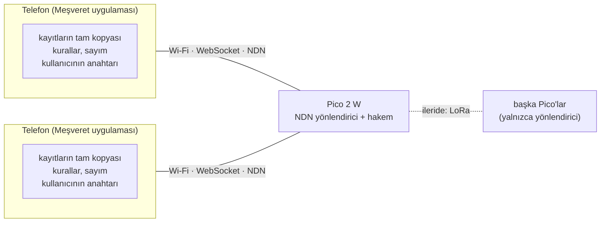

# Meşveret — Merkezsiz sürüm tasarımı (NDN, Pico 2)

> Durum: tasarım; kod yok. Bugünkü merkezî sürüm [DESIGN.md](DESIGN.md)'dedir. Bu belge 23 Ekim 2026 konuşmasındaki kararları toplar. **Karar** satırları (§2) verilmiş kararlardır. **Öneri** işaretli maddeler bu belgede türetildi ve onay bekliyor.

## 1. Amaç

Hoca, Meşveret'in NDN, mesh ağ ve federe sosyal medya gibi merkezsiz bir yapıda, bir Raspberry Pi Pico 2 üzerinde çalışabilecek biçimde kurulmasını istedi.

Bugünkü sürümde veri ve kurallar tek sunucudadır (FastAPI, PostgreSQL, Neo4j, üç düğümlü defter); uygulama yalnızca arayüzdür. Merkezsiz sürümde sunucu yoktur:

- Kullanmak isteyen herkesin cihazında uygulama vardır; veri telefonlarda dağıtık saklanır.
- Pico ağı taşır ve süreye bağlı kararları verir.

## 2. Verilen kararlar

| # | Karar |
|---|---|
| K1 | Sunucu ve uygulamanın yapısı Pico'ya konmaz. Kullanmak isteyen herkesin cihazında uygulama olur. |
| K2 | Veri dağıtık saklanır; istenince elinde olan herhangi bir kaynaktan alınır (torrent gibi). |
| K3 | Telefonlar bilgi taşıyıcıdır. Pico yönlendirici, karar verici ve arabulucudur (bu belgede: **hakem**). |
| K4 | Oy toplama, oy verme bittikten sonra bir süre sürer; süre geç gelen oylara göre uzar (momentum). Değerler §6.3'te. |
| K5 | Mahzen yazarlarının kimliğini Pico bilir. Pico kimliği yalnızca ifşa oylaması geçerse açıklar. |
| K6 | Mahzen içeriğinin telefonlardaki kopyalarda kalması kabul edilir. |
| K7 | Üyeliği Pico verir. |
| K8 | Donanım: tek Pico 2. Saat donanımı henüz seçilmedi (§11). |

## 3. Roller ve mimari



- **Uygulama (telefon):** topluluğun bütün metin kayıtlarını tutar ve eşitler. Kuralları (R1–R9, IK, Hâtif) ve sayımı yürütür. Kullanıcının anahtarını saklar ve kayıtlarını imzalar. Bütün uygulamalar aynı kodu çalıştırdığı için aynı kayıtlardan aynı sonucu bulur.
- **Pico:** iki işi var.
  - **Yönlendirici:** paketleri adlarına göre iletir, küçük bir önbellek tutar. Verinin içeriğine bakmaz; imzayı verinin alıcısı denetler.
  - **Hakem:** saati tutar, alındı verir, Karar Saati'ni açar ve kapatır, oyları açar, Mahzen'i yayımlar, üyelik belgesi verir. Kurallar ve sayım hakemde değil uygulamadadır (Öneri, §6.5).
- **Donanım:** Pico 2'de radyo yoktur. Telefonların bağlanabilmesi için **Pico 2 W** (Wi-Fi 4, Bluetooth 5.2) gerekir.
- **Tek Pico ve mesh:** tek Pico'yla ağ yıldız biçimindedir. Mesh için ikinci bir Pico ve LoRa kartı (SX1262) gerekir. Tasarım çok Pico'ya göre yazıldı: bir topluluğun tek hakemi olur, öteki Pico'lar yalnızca yönlendirir.

## 4. Ağ (NDN)

### 4.1 Adlar

```
/mesveret/<topluluk>/hakem/KEY                  hakemin açık anahtarı; topluluk kurulurken sabitlenir
/mesveret/<topluluk>/hakem/gelen/<rastgele>     telefondan hakeme giden Interest; içerik parametrede, şifreli
/mesveret/<topluluk>/hakem/alindi/<kayıt-hash>  hakemin imzalı alındısı
/mesveret/<topluluk>/hakem/gunluk/<sıra>        hakem günlüğü (§8)
/mesveret/<topluluk>/uye/<anahtar>/KEY          üyelik belgesi (hakem imzalı)
/mesveret/<topluluk>/<üye>/<sıra>               üyenin günlüğü: mesaj, öneri, itiraz, havale…
/mesveret/<topluluk>/mahzen/<başlık>/<sıra>     Mahzen yazıları (hakem yayımlar)
/mesveret/<topluluk>/gorsel/<sha256>/<parça>    görseller
/mesveret/<topluluk>/esitleme                   State Vector Sync Interest'leri
```

### 4.2 Yönlendirici

- **Interest gelince:** veri önbellekte varsa yönlendirici kendisi yanıtlar. Yoksa isteği bekleyen istekler tablosuna (PIT) yazar ve iletir.
- **Yolu bilinmeyen önek:** istek bütün bağlantılara yayılır. Data hangi bağlantıdan dönerse önek o yöne öğrenilir (NDN'in "self-learning" yöntemi); ayrı bir yönlendirme protokolü gerekmez.
- **Data dönünce:** bekleyenlere iletilir, önbelleğe konur. İstenmemiş Data atılır.
- **Döngü:** Interest'teki tek kullanımlık sayı (nonce) ile kesilir.
- **Koruma:** her bağlantının istek hızı sınırlanır.
- **LoRa (ileride):** paket en çok 255 bayttır; büyük paketler NDNLPv2 ile parçalanır. Görseller LoRa'dan geçmez.

### 4.3 Telefondan hakeme

- Telefon hakeme bir şey gönderirken `hakem/gelen/<rastgele>` adına bir Interest yollar. İçerik, Interest'in ApplicationParameters alanında, hakemin anahtarına şifreli taşınır.
- Hakemin yanıtı (Data) imzalı alındıdır.
- Ara Pico'lar yalnızca "hakeme şifreli bir şey gitti" görür. NDN paketlerinde gönderen adresi yoktur; hakem göndereni ağdan değil, şifreli zarfın içindeki üye imzasından öğrenir.
- **Öneri:** oylar, Mahzen yazıları ve üyelik istekleri aynı boya doldurulur; biri ötekinden ayırt edilemez.

### 4.4 Eşitleme ve dağıtık saklama (K2)

- **Eşitleme:** her üye kendi günlüğüne sıra numarasıyla yazar. Uygulamalar State Vector Sync ile "kimin kaçıncı kaydına kadar elimde var" vektörünü yayar; eksik kayıtlar adlarıyla istenir. Elinde kopyası olan her telefon ya da önbellek yanıt verebilir.
- **Metin:** her uygulama bütün metin kayıtlarını tutar. Metin küçük olduğu için parçalara bölünüp dağıtılmasına gerek yoktur.
- **Görseller:** parça parça istenir; parçalar birden çok telefondan gelebilir.
- **Telefonlar kapalıyken:** uygulama veriyi ancak açıkken verebilir. Android'de arka planda sürekli veri sunmak ayrı bir derleme ister; iOS'ta pratikte olmaz. Herkesin kapalı olduğu saatlerde veri, yazanı ya da kopyası olan biri dönene kadar alınamaz. Pico'ya microSD takılırsa sürekli açık bir kopya olur (açık karar, §11).

## 5. Üyelik ve kimlik (K7)

- **Kurulum (Öneri):** Pico ilk açılışta kendi anahtar çiftini üretir. Bilgisayara USB ile bağlıyken bir kurulum kodu yazar; bu kodu uygulamaya giren ilk kişi kurucu üye olur. Hakemin açık anahtarı topluluğun kimliğidir.
- **Davet (Öneri):**
  - Üye, uygulamasında tek kullanımlık ve imzalı bir davet QR'ı üretir.
  - Yeni gelen bu QR'ı yüz yüze okutur ve Pico'nun Wi-Fi ağına bağlanır.
  - Kayıt isteğini hakeme şifreli gönderir: açık anahtar, takma ad, doğum tarihi, il ve ilçe, davet.
- **Hakem ne yapar:**
  - Daveti doğrular ve 18 yaş koşulunu denetler.
  - Üyelik belgesini ve kapsam beyanlarını (şehir, yaş grubu) imzalar.
  - Doğum tarihi ve adres hakemde kalır, ağa çıkmaz. Ağda yalnızca "İstanbul kapsamında", "18–25" gibi imzalı beyanlar dolaşır.
  - Yaş grubu değişince yeni beyan yayımlar. Adres değişikliğindeki 90 günlük bekleme beyanda yazar.
- Davet zinciri (kim kimi davet etti) hakem günlüğüne yazılır; baskın tespitinde kullanılabilir.
- E-posta doğrulaması kalkar.

## 6. Oylama (Karar Saati)

### 6.1 Zaman damgası (Öneri)

Süreye bağlı bütün kurallar hakemin saatine göre işler: sessiz onay, itiraz, olgunlaşma, red bekleme, rakip metin, havale süresi ve Karar Saati. Bunun için her kayıt yayımlanmadan önce hakemden alındı alır:

1. Uygulama kaydı imzalar ve hakeme gönderir.
2. Hakem üyeliği ve imzayı denetler, alış anını yazar ve alındıyı imzalar.
3. Uygulama kaydı alındısıyla birlikte kendi günlüğünde yayımlar.

Tek Pico'lu kurulumda her paket zaten Pico'dan geçtiği için bu ek bir yol açmaz. Bedeli, hakemin her kayıt için bir imza atmasıdır (§10.1'de ölçülecek).

### 6.2 Oy

- Oy, taahhüdüyle (commit) birlikte hakemin anahtarına şifreli gider. İçinde oy verenin imzalı zamanı vardır.
- Hakem imzalı bir alındı döner ve taahhüdü kendi günlüğüne yazar. Taahhüt açık oylarda takma adla, gizli oylarda oturuma özel takma kimlikle yazılır (DESIGN §7.9 olduğu gibi; HMAC anahtarı hakemdedir).
- Hakem seçimleri kapanışta açar; pencere boyunca kimse ara sonucu göremez. Hakemin teknik olarak erken bakabilmesi bilinçli bir açıktır (§9).

### 6.3 Toplama ve momentum (K4)

T, pencerenin bitiş anıdır. Bir oyun sayılması için iki koşul gerekir: imzalı zamanı pencerenin içinde olmalı (T'den önce) ve hakeme toplama bitmeden ulaşmalı.

```
K = T + oy_toplama_en_az
geç ve geçerli bir oy a anında gelirse (a ≥ T, imzalı zamanı pencere içinde, a < K):
    K = min(max(K, a + oy_toplama_uzatma), T + oy_toplama_en_cok)
toplama K anında biter
```

İmzalı zaman hakemin saatinden ileride olamaz; küçük bir sapma payı tanınır.

| Madde | Değer | İzinli aralık |
|---|---|---|
| `oy_toplama_en_az` | 5 dk | 1–30 dk |
| `oy_toplama_uzatma` | 5 dk | 1–15 dk |
| `oy_toplama_en_cok` | 60 dk | 15–240 dk |

Gerekçe:

- **5 dakika:** tek Pico'lu kurulumda bir oyun gecikmesi, telefonun bir süre Wi-Fi menzilinden çıkıp geri dönmesi demektir. 5 dakika kısa kopuklukları karşılar. Bütün oylar zamanında geldiyse toplama 5 dakikada biter.
- **Uzatma:** her geç oy toplamayı 5 dakika uzatır; telefonlar dönmeye devam ettikçe toplama sürer.
- **60 dakikalık üst sınır:** saatini geri almış bir grup, oylarını azar azar göndererek toplamayı açık tutmaya çalışabilir. Böyle bir grup en çok 55 dakika kazanır; seçimler hâlâ kapalı olduğu için sonuca bakarak oy veremez.
- **Değişiklik:** maddeler mevcut yönetmelik düzeneğiyle (izinli aralık, R8) değişir ve sonraki oturumdan itibaren geçerli olur (DESIGN §5). `oy_toplama_en_cok`, `oy_toplama_en_az`'dan küçük olamaz.

### 6.4 Kapanış ve açılış

- **Kapanış kaydı:** toplama bitince hakem kapanış kaydını günlüğüne yazar. Kayıtta sayılan taahhütlerin listesi ve her birinin seçimi ve tuzu vardır. Herkes her taahhüdü yeniden hesaplayıp denetleyebilir.
- **Oy veren çevrimdışı olabilir:** oyu açmak için açılışta çevrimiçi olması gerekmez. Sonucu görüp kendi oyunu açmamak diye bir yol da yoktur.
- **Alındı kanıttır:** alındısı olduğu hâlde kapanış listesinde yer almayan oy, hakemin oyu düşürdüğünün kanıtıdır; uygulama bunu gösterir.
- **Ulaşmayan oy:** hakeme toplama bitene kadar ulaşmayan oy sayılmaz. Herkesin aynı sonucu bulması, her oyun sayılmasından önce gelir.

### 6.5 Sonucun hesaplanması (Öneri)

- **Oturum açılışı:** oturum açılırken hakem günlüğüne bir "oturum açıldı" kaydı yazar. Kayıtta o anki durum vektörü (hangi üyenin kaçıncı kaydına kadar) ve oylanacak öneriler bulunur.
- **Anlık görüntü:** seçmen listesi, havale haritası, yönetmelik değerleri ve baskın dışlaması bu vektörün kapsadığı kayıtlardan hesaplanır; herkes aynısını bulur.
  - Havale kilidi kendiliğinden gelir: vektörden sonra verilen havale bu oturumu etkilemez.
- **Sayım:** sayımı uygulamalar yapar. Kapanış kaydı ve anlık görüntü herkeste aynı olduğu için hepsi aynı sonucu bulur. Hâtif'in oyu da her uygulamada aynı kurallarla hesaplanır; Hâtif'in anahtarı yoktur.
- **Pico ve yönetmelik:** Pico sayım yapmaz, ama kendi işlerini yönetmelik değerlerine göre yürütür (oy toplama, Mahzen kapasitesi, Karar Saati takvimi). Bu değerler değiştiğinde Pico'nun yeni değeri nasıl öğreneceği açık bir karardır (§11).

## 7. Mahzen (K5, K6)

- **Yayımlama:** telefon Mahzen yazısını kendisi yayımlamaz, hakeme şifreli gönderir (§4.3). Hakem yazıyı `mahzen/<başlık>/<sıra>` adıyla, kendi anahtarıyla yayımlar. Ağda yazıyla yazarı arasında bir bağ görünmez.
- **Gölge kimliği:** bugünkü gibi HMAC'le üretilir, ama anahtar başlığa özeldir: `HMAC(başlık_gizli_değeri, üye ‖ başlık)`. Başlığın gizli değeri yalnızca hakemde durur.
- **Başlık kuralları:** başlık sırası, yükselme, `mahzen_kapasite`, `mahzen_ust_sinir` ve uyarı onayını hakem uygular. Yazıları yayımlayan o olduğu için sıra herkeste aynıdır.
- **İfşa oylaması:** DESIGN §10'daki gibidir. Oylar hakeme şifreli gider, gizlidir ve değiştirilebilir. Hakem oyları anında sayar; EVET sayısı `mahzen_ifsa_esigi` × seçmen sayısını aştığı an oylama geçer.
- **Kimliğin açıklanması:**
  - Kimlik hakemden yalnızca bir ifşa kaydıyla çıkar. Kayıt, oylamanın seçmen listesini ve sayıları taşır.
  - Her seçmen kendi oyunun doğru sayıldığını alındısıyla denetler.
  - Bu denetim, oy vermemiş bir seçmen adına eklenmiş sahte bir EVET'i yakalamaz (§9).
- **Başlığın ölümü:**
  - Başlık ölünce hakem bir "başlık öldü" kaydı yayımlar ve başlığın gizli değerini siler.
  - Bundan sonra telefonlarda kalan kopyalardan yazarı kimse, hakem de dahil, çıkaramaz.
  - Uygulama ölen başlığı göstermez; kopyaların silindiği garanti edilmez (K6).
- **Günlük:** yaşayan başlıklar hakem günlüğüne yazılmaz (bugünkü defter kuralı); ifşa kaydı yazılır.

## 8. Defterin yerine

- Bugünkü üç düğümlü defterin yerini iki tür zincir alır:
  - **Üye günlükleri:** her kayıt bir önceki kaydın hash'ini taşır ve üyenin anahtarıyla imzalıdır.
  - **Hakem günlüğü:** oturum açılışları, taahhütler, kapanışlar, ifşa kayıtları, üyelik belgeleri, davet zinciri, başlık ölümleri ve yönetmelik durumu.
- Her uygulama iki zincirin de kopyasını tutar ve doğrular; bu, bugünkü `/verify`'ın karşılığıdır.
- Hakem geçmişini değiştiremez. Aynı sıra numarasıyla iki farklı kayıt imzalarsa, bu iki imzalı kayıt birlikte hilesinin kanıtı olur.
- Lider ve takipçi ayrımı kalkar; her telefon bir kopyadır.
- Silme kararı içeriği uygulamalarda gizler, kayıtlar zincirde kalır (bugünkü gibi). Telefonlardaki kopyalardan silmek zorlanamaz.

## 9. Bilinçli açıklar

1. **Hakem güvenilen taraftır.**
   - Pencere sırasında oyları görebilir.
   - Mahzen kimliklerini kayıt dışı sızdırabilir.
   - Oy vermemiş seçmenler adına ifşa oyu ekleyebilir.

   Bunları önleyen tek şey Pico'nun güvenilir ellerde tutulmasıdır. Pico çalınırsa anahtarı ve yaşayan başlıkların gizli değerleri de gider. RP2350'nin anahtar saklama alanı (OTP) ve imzalı açılışı bunu zorlaştırır ama engellemez.
2. **Tek Pico tek hata noktasıdır.** Pico kapalıyken ağ yoktur; telefonlar birbirine yalnızca Pico üzerinden ulaşır.
3. **Oy zamanı beyandır.** Oyun imzalı zamanını telefon yazar. Saatini geri alan biri, pencere kapandıktan sonra en çok `oy_toplama_en_cok` kadar daha oy verebilir. Seçimler kapalı olduğu için sonuca bakarak oy veremez.
4. **Ulaşmayan oy sayılmaz.** Hakeme toplama bitene kadar ulaşamayan oy sayılmaz.
5. **Kopyalar zorlanamaz.** Silme kararları ve Mahzen'in ölümü telefonlardaki kopyalara zorlanamaz; değiştirilmiş bir uygulama her şeyi saklayabilir.
6. **Kurala aykırı kayıtlar dolaşabilir.** Uygulamalar bu kayıtları yok sayar. Yönlendirici içeriğe bakmadığı için çöp veriyle yüklenebilir; tek önlemi bağlantı başına hız sınırıdır.
7. **Yaş ve adres beyandır** (bugünkü gibi). Davet eden, davet ettiği kişiye kefil olur ama beyanını doğrulamaz.
8. **Herkes kapalıyken veri alınamaz** (§4.4).

## 10. Uygulama

- **Pico:** MicroPython.
  - İmza ve şifre çözme MicroPython'da yoktur. Monocypher'ı (Ed25519, X25519) C modülü olarak ekleyen özel bir derleme gerekir.
  - Depolama flash'ta, LittleFS ile.
  - Pico kodu önce bilgisayarda, MicroPython'ın unix sürümüyle denenir: sahte saat ve taklit bağlantılarla, birden çok kopya hâlinde.
- **Telefon:** mevcut Expo uygulaması.
  - Veri katmanı HTTP'den NDN'e geçer: NDN'in TypeScript kütüphanesi NDNts (WebSocket bağlantısı, State Vector Sync) ve telefonda yerel bir depo.
  - Kurallar ve sayım (bugün `api/src/mesveret/domain`, 2.782 satır Python) TypeScript'e taşınır.
  - Takvim, dilekçe, gazete, bildirim ve arama kayıtlardan uygulamada türetilir; Pico'yu ilgilendirmez.
- **Mevcut kod:**
  - **Öneri:** Python alan katmanı başvuru uygulaması olarak kalır; TypeScript kodu aynı senaryolarla ona karşı sınanır.
  - Merkezî sürüm (FastAPI, PostgreSQL, Neo4j, defter) bugünkü hâliyle kalır.

### 10.1 Ölçülecekler

Bunlardan biri kötü çıkarsa tasarım değişir:

1. RP2350'de Ed25519 imzalama ve doğrulama ile X25519 süreleri. Hakem her kayıt için bir alındı imzalar.
2. Wi-Fi açıkken MicroPython'a kalan bellek.
3. Pico 2 W'nin erişim noktasına aynı anda kaç telefonun bağlanabildiği.
4. Android'in internetsiz bir Wi-Fi ağında kalıp kalmadığı.
5. NDNts'in React Native'de çalışıp çalışmadığı.
6. Sürekli eklenen günlüklerin flash'ı ne kadar aşındırdığı.
7. Bir dönemlik metnin boyutu ve telefonda tam eşitlemenin süresi.

## 11. Açık kararlar

1. **Saat.** Pico 2 kartında pilli saat yoktur; elektrik kesilince saat sıfırlanır.
   - Önerim pilli bir saat modülü (DS3231, I²C).
   - Modül alınana kadar Pico, açılışta saati kurucunun telefonundan, kurucunun imzasıyla alır. Saat kurulmadan süreye bağlı karar vermez.
2. **Pico'nun yönetmelik değerlerini öğrenmesi.** Pico sayım yapmadığı için, kendi kullandığı maddelerde (oy toplama, Mahzen, Karar Saati takvimi) oylanan değişikliği kendisi hesaplayamaz. İki seçenek:
   - **Önerim:** uygulamalar sonuçları imzalayıp yayımlar. Pico, en az k farklı üyenin aynı sonucu yayımladığı ve çelişen bir sonucun olmadığı değeri benimser. Pico yanlış bir değer uygularsa her uygulama bunu kendi hesabıyla görür.
   - Pico, yalnızca YONETMELIK oylamalarında sayımı kendisi yapar. Bunun için havale ve eşik hesabı Pico'ya taşınır.
3. **microSD.** Pico'ya microSD takılıp sürekli açık bir kopya olsun mu (§4.4)?
4. **Etkin üye.** İtiraz eşiği, kapsamdaki etkin üye sayısına bağlı; bugün bu son girişe göre hesaplanıyor. Merkezsiz sürümde "etkin" sayılmak, hakemden son alındının alındığı zamana bağlanabilir.
5. **Mahzen ifşa seçmenlerinde baskın dışlaması.** Bugün baskın işaretli hesaplar ifşa seçmenlerinden çıkarılıyor; Pico ise baskın tespiti yapmıyor. Ya uygulamaların hesabı Pico'ya 2. maddedeki yolla bildirilir, ya da Mahzen'de bu dışlama kalkar.
