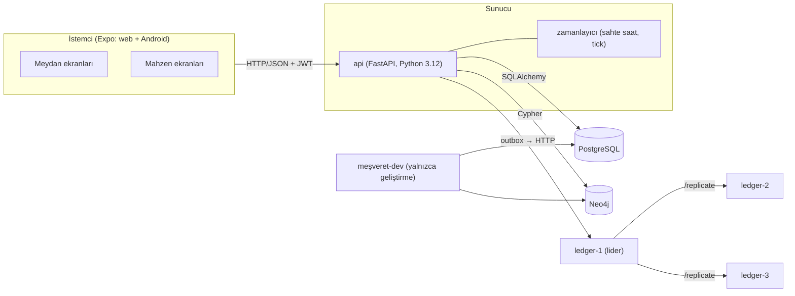
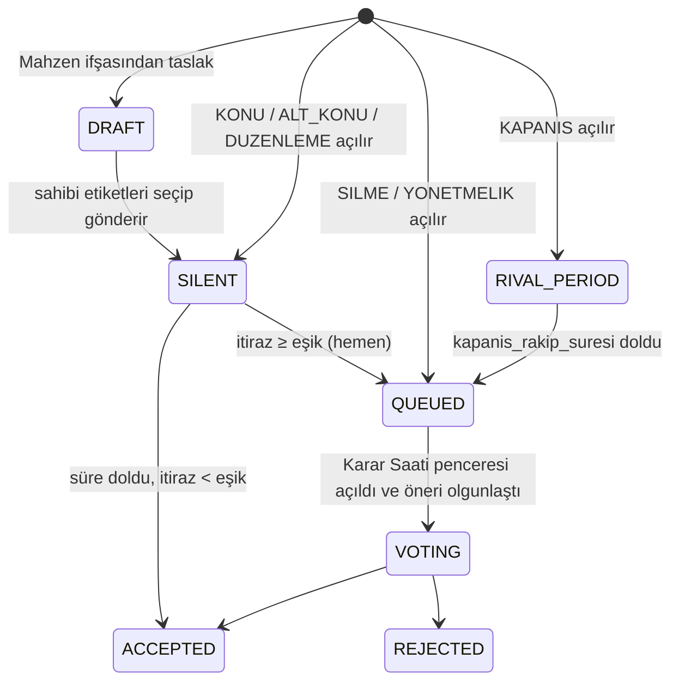

# Meşveret — Tasarım Belgesi

> Durum: uygulamayla güncellenmiş son sürüm. Kurulum ve demo adımları için [README.md](README.md).

## 1. Amaç ve temel iddia

Meşveret, herkesin konu önerebildiği, konuların ve yapısal değişikliklerin oylamayla kabul edildiği bir forumdur. İki modu vardır:

- **Meydan** — açık, kimlikli, kalıcı forum.
- **Mahzen** — anonim, geçici, isteğe bağlı felsefe tartışma alanı (diskur). Teşvik edilmez.

Temel iddia: sistem çoğunluk tiranlığını ortadan kaldırmaz. Onu dört mekanizmayla sınırlar:

1. **Kapsam** — bir karara yalnızca etkilenen kaynağın sahibi olan kapsam (ya da onun alt kümesi) oy verir.
2. **Havale** — oy hakkı, alan bazında güvenilen kişilere devredilebilir; uzmanlık görünür olur.
3. **Nitelikli çoğunluk** — kuralların kendisini değiştirmek 2/3 ister.
4. **Azınlık şerhi** — kaybeden taraf, karara silinemez bir görüş ekler.

Kalan açıklar §15'te bilinçli olarak belgelenmiştir.

## 2. Mimari

| Bileşen | Sorumluluk |
|---|---|
| `api/` | Kimlik, öneri motoru, şeritler, havale, Karar Saati, Mahzen, Hâtif, zamanlayıcı, geliştirme CLI'ı |
| `ledger/` | Sadece eklenebilir, hash zincirli log; üç düğüm, sabit lider, HTTP çoğaltma, `/verify` |
| `client/` | Expo + expo-router + TypeScript; tek kod tabanı (web + Android) |
| PostgreSQL | Kimlik, içerik, sürümler, öneriler, itirazlar, oturumlar, oylar ve tuzlar, anlık görüntüler, Mahzen, defter outbox'ı, sahte saat |
| Neo4j | Kullanıcı grafı, havale grafı, etkileşim grafı, alan hiyerarşisi, kapsam ve kaynak sahipliği, yönetmelik maddeleri |

### 2.1 Katmanlar (api)

- `domain/` — saf fonksiyonlar: havale çözümleme, döngü kontrolü, ağırlık ve sayım, R1–R7, Hâtif etiket denetimi, baskın tespiti, başlık kimliği, diff. Veritabanı bilmez; testlerin büyük kısmı burada.
- `graph/` — Neo4j erişimi. `OntologyView` protokolünün Neo4j uygulaması (Cypher).
- `db/` — SQLAlchemy 2 modelleri.
- `services/` — iş akışları; domain fonksiyonlarını veri katmanlarıyla birleştirir.
- `routers/` — HTTP uç noktaları.

`OntologyView` protokolünün bir bellek içi, bir de Neo4j uygulaması vardır. İkisi aynı sözleşme testlerinden geçer. Böylece kurallar Docker olmadan test edilir, Cypher sorguları da aynı beklentilere karşı doğrulanır.

### 2.2 Tutarlılık

- Üç depo arasında dağıtık işlem yoktur. PostgreSQL işlemsel çekirdektir.
- Bir servis çağrısı önce PostgreSQL işlemini tamamlar, ardından Neo4j'yi günceller.
- Deftere gidecek kayıt, aynı PostgreSQL işlemi içinde `ledger_outbox` tablosuna yazılır. İstek sonunda lidere senkron gönderilir; başarısız olursa arka planda sırayla yeniden denenir. Defterdeki sıra böylece PostgreSQL'deki sırayla aynı kalır.
- Neo4j yazımı PostgreSQL commit'inden sonra başarısız olursa iki depo ayrışabilir. Ödev ölçeğinde bu kabul edilmiştir. `meşveret-dev seed --reset` her şeyi yeniden kurar.

## 3. Veri yerleşimi

| Veri | Depo | Not |
|---|---|---|
| Kullanıcı kimliği, şifre özeti (argon2), adres, doğum tarihi | PostgreSQL | Ad soyad, adres ve doğum tarihi yalnızca sahibine döner |
| `User` düğümü (id, takma ad) | Neo4j | Graf ilişkileri için |
| Konu, mesaj, mesaj sürümleri | PostgreSQL | Her satır kendi defter hash'ini taşır |
| Öneri kaydı, durum, itirazlar | PostgreSQL | `Oneri` düğümü + `ETKILER`/`SECMEN` Neo4j'de |
| Oylar, tuzlar, anlık görüntüler | PostgreSQL | Commit ve açılış deftere de yazılır |
| Alan ağacı, Kapsam, UYE, Kaynak, SAHIBI | Neo4j | Ontoloji |
| HAVALE, ETKILESIM | Neo4j | Karar Saati'nde PostgreSQL'e anlık görüntü alınır |
| YonetmelikMaddesi (değerler) | Neo4j | Kod eşik ya da süre sabiti içermez |
| Mahzen başlıkları ve mesajları | PostgreSQL | `Diskur` düğümü + yazar ilişkileri Neo4j'de (baskın tespiti için) |
| Defter kayıtları | ledger-1..3 (her birinde ayrı SQLite) | Silinmez |

## 4. Ontoloji (Neo4j)

### 4.1 Düğümler

| Etiket | Temel özellikler |
|---|---|
| `User` | `id`, `takma_ad`, `rol` (`CITIZEN` / `ORACLE`), `created_at` |
| `Alan` | `id`, `ad`, `anahtar_kelimeler` (Hâtif için) |
| `Kapsam` | `id`, `tur` (`GENEL` / `NITELIK` / `ILGI`), `alt_tur` (`SEHIR` / `YAS_GRUBU`), `deger` (ör. "İstanbul", "25-34", alan id) |
| `Kaynak` | `id`, `tur` (`ALAN` / `KONU` / `YONETMELIK_MADDESI` / `ORTAK`), `ad`, `bolunebilir`, `bolunme_turu` (ör. `SEHIR`), `paylar` (ör. şehir → puan) |
| `Konu` | `id`, `baslik`, `alan_id`; aynı zamanda bir `Kaynak` |
| `Oneri` | `id`, `tur`, `durum` |
| `Karar` | `id`, `konu_id`, `metin_id` |
| `YonetmelikMaddesi` | `anahtar`, `deger` (tipli JSON), `sema`, `aciklama`; aynı zamanda bir `Kaynak` |
| `Diskur` | `id` (Mahzen başlığı; başlık silinince düğüm de silinir) |

`Konu` ve `YonetmelikMaddesi` düğümleri ek olarak `Kaynak` etiketini taşır. Böylece sahiplik kuralları her kaynak türüne aynı biçimde uygulanır.

### 4.2 İlişkiler

| İlişki | Anlam |
|---|---|
| `(Alan)-[:ALT_ALANI]->(Alan)` | Ağaç. Ok alttan üste gider: `(alt)-[:ALT_ALANI]->(üst)` ("alt, üstün alt alanıdır"); `ALT_KUMESI` ve `ALT_KONUSU` ile aynı yön |
| `(User)-[:UYE {since, neden}]->(Kapsam)` | `neden`: `KAYIT`, `ADRES_DEGISIKLIGI`, `YAS`, `KATILIM` |
| `(Kapsam)-[:ALT_KUMESI]->(Kapsam)` | Ontolojik alt küme ilişkisi. Her NITELIK ve ILGI kapsamı GENEL'in alt kümesidir |
| `(Kaynak)-[:SAHIBI]->(Kapsam)` | Kaynağın sahibi olan kapsam |
| `(User)-[:HAVALE {alan_id \| null, since}]->(User)` | `alan_id = null` genel havale |
| `(Oneri)-[:ETKILER]->(Kaynak)` | Önerinin etkilediği kaynaklar |
| `(Oneri)-[:SECMEN]->(Kapsam)` | Önerinin seçmen kapsamı (tek) |
| `(User)-[:ETKILESIM {agirlik}]->(User)` | Türetilmiş ilişki grafı (§9) |
| `(User)-[:YAZDI {ilk}]->(Diskur)` | Mahzen başlığına ilk yazış anı |
| `(Konu)-[:ALANINDA]->(Alan)`, `(Konu)-[:ALT_KONUSU]->(Konu)` | Konu yerleşimi |

### 4.3 Kapsam türleri

- **GENEL** — e-postası doğrulanmış herkes. Oy hakkı hemen doğar.
- **NITELIK** — profil verisinden sistem hesaplar; kullanıcı katılamaz ya da ayrılamaz.
  - Şehir: adresin `il` alanından.
  - Yaş grubu: doğum tarihinden (18-24, 25-34, 35-49, 50+), o anki sahte saate göre hesaplanır.
  - Adres değişikliğinde eski şehir üyeliği hemen biter. Yeni şehirde oy hakkı `adres_bekleme` (90 gün) sonra doğar. Kayıttaki ilk şehirde oy hakkı hemen doğar (bkz. §15.3).
- **ILGI** — bir Alan'a üyelik. Kullanıcı katılır ya da ayrılır. Oy hakkı `ilgi_bekleme` (14 gün) sonra doğar.

**Alt küme ilişkisi ontolojiktir.** "İstanbul ⊂ GENEL" bir `ALT_KUMESI` kenarıyla tanımlanır, iki kapsamın o anki üye listeleri karşılaştırılarak hesaplanmaz. Üye listesi zamanla değişir; kimin kimin parçası olduğu ise yapısal bir iddiadır. İlgisiz iki kapsam (ör. İstanbul ve ILGI:Sinema) birbirinin alt kümesi değildir.

### 4.4 Kaynaklar ve sahiplik

| Kaynak | Sahibi | Bölünebilir |
|---|---|---|
| Alan | GENEL | Hayır |
| YonetmelikMaddesi | GENEL | Hayır |
| Konu | Konuyu kabul eden önerinin seçmen kapsamı | Hayır |
| "Etkinlik bütçesi" (tohum) | GENEL | Evet, şehir bazında; puan cinsinden paylar (İstanbul 4.000, Ankara 6.000, İzmir 5.000, Bursa 5.000) |
| "Ortak toplantı salonu" (tohum) | GENEL | Hayır |

Bütçe yalnızca paylarıyla temsil edilir; kaynağın toplamı payların toplamıdır (tohumda 20.000 puan). Bir dağıtım motoru yoktur; kararın hangi payı etkilediği öneride ve kararda gösterilir.

## 5. Yönetmelik = veri

Tüm eşikler ve süreler `YonetmelikMaddesi` düğümlerinde durur. Kod bunları `regulation.get(anahtar)` ile okur; sabit yazılmış eşik yoktur.

- Oranlar kesir olarak saklanır (`"2/3"`). Böylece 20/30 gibi sınır durumları kayan nokta hatası olmadan karşılaştırılır.
- Her maddenin bir değer şeması vardır. YONETMELIK önerisi açılırken yeni değer bu şemaya göre doğrulanır.

| Madde | Varsayılan | Anlam |
|---|---|---|
| `sessiz_onay_suresi` | 24 saat | Hızlı şerit açık kalma süresi |
| `itiraz_esigi` | `{min: 3, oran: 1/20, aktiflik_gun: 30}` | max(3, kapsamdaki aktif üyelerin %5'i); aktif = son 30 günde giriş |
| `basit_cogunluk` | `{oran: 1/2, karsilastirma: ">"}` | Kullanılan oyların yarısından fazlası |
| `yonetmelik_esigi` | `{oran: 2/3, karsilastirma: ">="}` | Kullanılan oyların en az 2/3'ü |
| `silme_esigi` | `{oran: 2/3, karsilastirma: ">="}` | Başkasının içeriğini silmek için kullanılan oyların en az 2/3'ü (§7.4) |
| `red_bekleme` | 30 gün | Reddedilen hedefe yeniden öneri yasağı |
| `musavir_esigi` | 5 | Alan bazında doğrudan alınan havale sayısı |
| `ilgi_bekleme` | 14 gün | ILGI kapsamında oy hakkı beklemesi |
| `adres_bekleme` | 90 gün | Adres değişikliğinden sonra yeni şehirde oy hakkı beklemesi |
| `karar_saati` | `{gun: PAZAR, saat: "20:00", tz: "Europe/Istanbul", pencere_dakika: 60}` | Haftalık oylama oturumu |
| `kapanis_rakip_suresi` | 48 saat | KAPANIS'a rakip metin ekleme süresi |
| `yeniden_acma` | 90 gün | Kararlı konunun yeniden açılabilmesi için geçmesi gereken süre |
| `mahzen_kapasite` | 100 başlık | Aşılınca en alttaki başlık kalıcı silinir |
| `mahzen_ust_sinir` | 300 yanıt | Sonrasında başlık yükselemez |
| `mahzen_ifsa_esigi` | `{oran: 1/2, karsilastirma: ">"}` | İfşa için EVET sayısı / seçmen listesi |
| `baskin_yeni_uye_suresi` | 7 gün | Anlık görüntüden bu kadar önce ya da sonra katılanlar "yeni" sayılır |
| `baskin_katilim_araligi` | 24 saat | Bir kümenin katılım anlarının en fazla yayılabileceği aralık |
| `baskin_min_kume` | 4 | İşaretlenecek en küçük küme |
| `baskin_yogunluk_esigi` | 1/2 | Kümedeki kenar yoğunluğu eşiği |
| `baskin_min_agirlik` | 1 | Kümeleme için en düşük ETKILESIM ağırlığı |
| `etkilesim_agirliklari` | `{yanit: 1, havale: 2, yakin_kayit: 1, yakin_kayit_dk: 60, ortak_baslik: 0.5, ortak_baslik_dk: 30}` | ETKILESIM sinyal ağırlıkları |
| `olgunlasma_dar` | 48 saat | Dar etkili önerinin Karar Saati'nden önce yayında kalma süresi (§7.2) |
| `olgunlasma_genis` | 72 saat | Geniş etkili öneri için aynı süre |
| `olgunlasma_genel` | 7 gün | Genel kapsamlı ve yönetmelik önerileri için aynı süre |

**İçerik kuralları.** Yönetmelikte parametrelerin yanında ikinci bir madde türü vardır: içerik kuralı (`icerik_kurali`). Bir içerik kuralı sayı değil metindir: başlık, kuralın metni ve Hâtif'in denetimde kullandığı anahtar kelimeler. Başkasının içeriğini silme önerisi en az birine dayanmak zorundadır (R7, §7.4).

| Kural | Başlık | Kapsadığı |
|---|---|---|
| `IK-1` | Spam ve reklam | Tartışmayla ilgisi olmayan ticari tanıtım, reklam, aynı iletinin tekrarı |
| `IK-2` | Hakaret ve tehdit | Kişiyi ya da grubu aşağılayan söz, küfür, zarar verme tehdidi. Sert eleştiri hakaret değildir |
| `IK-3` | Başkasının kişisel bilgilerini ifşa etme | Başkasının telefonu, adresi, kimlik numarası gibi bilgilerini rızası olmadan paylaşmak |

"Konu dışı" gibi geniş bir kural bilerek yoktur: neyin konu dışı olduğunu çoğunluk belirler ve böyle bir kural, çoğunluğun beğenmediği her görüşü silmenin gerekçesi olur. Tohumdaki bu dar küme bir başlangıçtır, sınır değildir. Kural kümesi de oylanır (bkz. §15):

- **Değiştirme:** kuralın başlığı, metni ve anahtar kelimeleri YONETMELIK önerisiyle değişir.
- **Ekleme:** YONETMELIK önerisi (`article_action: ekle`) yeni kuralın başlığını, metnini ve anahtar kelimelerini taşır. Kod (IK-<n>) öneri açılırken verilir: yürürlükteki, kaldırılmış ve önerilmiş kodların en büyüğünün bir fazlası. Reddedilen ekleme yeni bir kodla hemen geri gelemez; R6'nın hedef anahtarı kuralın başlığıdır.
- **Kaldırma:** YONETMELIK önerisi (`article_action: kaldir`) yürürlükteki bir kuralı kaldırır. Kaldırılan kurala dayanan yeni silme önerisi R7'de reddedilir; kuyruktaki silme önerilerinde Hâtif HAYIR der (R7 oylama anında yeniden çalışır). Kaldırılan kodun geçmişi yönetmelik sayfasında kalır ve kod bir daha kullanılmaz; böylece eski sansür şeritlerindeki "IK-3 gereğince silindi" ifadesi başka bir kuralı göstermeye başlamaz.

Üçü de diğer yönetmelik değişiklikleri gibi Genel kapsamda, yavaş şeritte, `yonetmelik_esigi` (2/3) ile oylanır. Parametre maddeleri eklenemez ve kaldırılamaz; yalnızca değerleri değişir, çünkü kod onları okur.

Belgede verilen ilk 13 madde aynen alınmıştır. `mahzen_ifsa_esigi`, baskın ve etkileşim maddeleri belgenin "eşikler yönetmelik maddesi olarak durur" gereği eklenmiştir. `olgunlasma_*` maddeleri sonradan istenen olgunlaşma kuralından, `silme_esigi` ve içerik kuralları silmenin sıkılaştırılmasından gelir.

**Değişiklik kuralları:**

- Her madde yalnızca YONETMELIK önerisiyle, GENEL kapsamda, yavaş şeritte, `yonetmelik_esigi` ile değişir (R3). İçerik kuralı eklemek ve kaldırmak da buna dahildir; kural ekleme önerisinin ETKILER etiketi kural kümesidir (`madde:icerik_kurallari`).
- `yonetmelik_esigi` maddesinin kendisi de aynı eşikle değişir; muafiyet yoktur (kendini koruma). Oylama o anki değerle yapılır.
- Karar Saati penceresi açılırken tüm madde değerlerinin anlık görüntüsü alınır. O oturumda kabul edilen bir değişiklik bir sonraki oturumdan itibaren geçerlidir. Böylece aynı oturumdaki başka bir oylamanın eşiği sayım sırasında değişmez.

## 6. Denetim kuralları

Her öneri açılırken kurallar çalışır. İhlal varsa öneri kaydedilmez ve Türkçe gerekçe döner. Kurallar saf fonksiyonlardır, `OntologyView` üzerinden çalışır.

| Kural | İçerik | Gerekçe |
|---|---|---|
| **R1** | ALT_KONU'nun alanı, üst konunun alanının kendisi ya da alt ağacında olmalı | Konu ağacı alan ağacıyla çelişmez; alt konu üst konunun konusundan kopamaz |
| **R2** | Seçmen kapsamı S, etkilenen her kaynağın sahibi O için: S = O ise geçer. S ⊂ O ise: kaynak S'nin türüne göre bölünebiliyorsa etki S'nin payına daraltılır ve öneride gösterilir ("Bu karar yalnızca İstanbul payını etkiler"); bölünemiyorsa red. S ⊄ O ise (üst küme ya da ilgisiz) red ("Bu kapsam bu kaynak hakkında karar veremez: kaynağın sahibi X") | Karar veren grup, kaynağa sahipliğini ontolojide göstermek zorundadır (ispat yükünün tersine çevrilmesi). Çoğunluk, azınlığa ait kaynak hakkında karar veremez |
| **R3** | YonetmelikMaddesi'ni etkileyen öneri YONETMELIK türünde olmalı; seçmeni GENEL, şeridi yavaş, eşiği `yonetmelik_esigi` | Kurallar herkesi bağlar; hızlı ve sessiz değişemez |
| **R4** | Havale döngüsü yasak (alan başına; mirası da kapsar, §8.2) | Döngüde oy hiçbir yere varmaz |
| **R5** | Oy hakkı = kapsam üyeliği + ilgili bekleme süresinin dolmuş olması. Öneri sahibi de seçmen kapsamında oy hakkına sahip olmalı | Bir gruba, o grubun parçası olmayan biri öneri getiremez; yeni katılanlar hemen karar veremez |
| **R6** | Aynı hedefe oylamayla reddedilmiş öneri `red_bekleme` süresince yeniden açılamaz | Aynı öneriyi üst üste açarak yıpratmayı önler |
| **R7** | Başkasının içeriğini silme önerisi en az bir içerik kuralına (IK-1…) dayanmalı ve kuralı ihlal eden kısmı hedef metinden aynen alıntılamalı. Alıntı hedefin güncel metninde bütün kelimelerle, art arda geçmeli (büyük/küçük harf ve noktalama farkı yok sayılır). Yazarın kendi mesajı için gerekçe gerekmez; konu silme hiçbir zaman "kendi" sayılmaz | Silme istisnadır; gerekçesiz silme, çoğunluğun beğenmediği görüşü gizlemesinin yoludur (§7.4) |

**red_bekleme hedef anahtarı:** KONU → (alan, normalize başlık); ALT_KONU → (üst konu, normalize başlık); DUZENLEME ve SILME → içerik; YONETMELIK → madde; KAPANIS → konu. Yalnızca oylamayla reddedilen öneriler sayılır; açılışta denetimden dönenler kayda girmez.

**Daralmanın sunumu.** Daralan öneride oylanan şey talep değil etkidir; arayüz bunu başlıkta gösterir. Başlık alanı iki satırdır: üstte küçük ve üstü çizili "Talep: Etkinlik bütçesinin tamamı İstanbul'a", altta büyük "Etki: Etkinlik bütçesinin İstanbul payı". Etki başlığı otomatik üretilir: kaynak adının tamlayan hâli + kapsam adı + "payı". Daralma kutusu oranı ("4.000 / 20.000 puan (%20)") ve bir çubuğu gösterir: kaynağın tamamı gri, etkilenen pay bordo. Etkilenen kaynaklar listesinde kaynak "Etkinlik bütçesi — yalnızca İstanbul payı (4.000 / 20.000)" diye yazılır. Hâtif'in yorumu da daralmayı anar: "Talep kaynağın tamamını hedefliyordu; seçmen kapsamı yalnızca İstanbul payına karar verebilir, daraltma uygulandı." Öneri listelerindeki kartlar aynı düzeni kullanır. Daralan öneri kabul edilip konu olduğunda konu sayfası ve konu listeleri de aynı iki satırlı başlığı ve daralma kutusunu gösterir; konunun kapsamı talep değil etkidir.

**Türe özgü geçerlilik:** hedef mevcut ve açık olmalı; kendi tartışma mesajı için DUZENLEME açılamaz (serbest sürümleme var); Şerh hiçbir önerinin hedefi olamaz; aynı konuda ikinci KAPANIS açılamaz (rakip metin olarak eklenir); yeniden açma `yeniden_acma` süresine bağlıdır.

**Etiketleri öneri sahibi seçer.** Seçmen kapsamını ve KONU'da etkilenen kaynakları öneriyi açan kişi belirler. Otomatik bağlanan etiketler: SILME, DUZENLEME ve KAPANIS'te hedef konu; YONETMELIK'te madde.

### 6.1 Hâtif'in etiket denetimi

Hâtif her yeni öneriye bir "etiket önerisi" yorumu bırakır. Denetim kural tabanlı ve deterministiktir:

- **H1 — Alan:** başlık ve metindeki kelimeler alanların `anahtar_kelimeler` listeleriyle eşlenir. En çok eşleşen alan (en az 2 eşleşme) seçilen alan değilse ve seçilen alan onun atası da değilse, uyuşmazlık sayılır.
- **H2 — Etiketlenmemiş kaynak:** metin bir kaynağın adını ya da eş adını geçiriyor ama öneri o kaynağı ETKILER olarak etiketlememişse uyuşmazlık sayılır. Bu denetim, R2'den kaçmak için kaynak etiketini atlama manipülasyonunu yakalamaya yöneliktir.
- **H3 — Şehir:** metin tek bir şehrin adını geçiriyor, seçmen kapsamı ise başka bir şehrin kapsamıysa uyuşmazlık sayılır.
- **H4 — İçerik kuralı (yalnızca SILME):** dayanılan her içerik kuralının anahtar kelimelerinden en az biri, ihlal edildiği söylenen alıntıda geçmeli. Karşılığı olmayan kural varsa HAYIR. Hâtif hangi kelimeyi bulduğunu ya da bulamadığını yorumuna yazar: "İçerik kuralı IK-2 (Hakaret ve tehdit): belirtilen kısımda karşılığı var ('cahil')." Kendi mesajının silinmesinde bu denetim yapılmaz.

**Hâtif'in oyu:** oylama anında R1–R7 yeniden çalışır ve H1–H4 değerlendirilir. Hepsi geçerse EVET, biri bile geçmezse HAYIR. R1–R7'yi ihlal eden öneriler açılışta zaten reddedildiği için, H1–H4 olmasa Hâtif pratikte her öneriye EVET derdi. R7 oylama anında hedefin güncel metniyle yeniden çalışır: yazar ihlal eden kısmı oylamadan önce düzeltirse alıntı artık metinde geçmez ve Hâtif HAYIR der.

## 7. Öneri yaşam döngüsü

### 7.1 Hızlı şerit (sessiz onay)

- KONU, ALT_KONU ve DUZENLEME `sessiz_onay_suresi` boyunca açık kalır.
- Seçmen kapsamında R5'e göre oy hakkı olan herkes bir kez itiraz edebilir. İtiraz kişiseldir; havale uygulanmaz.
- Eşik `itiraz_esigi`dir ve kapsamdaki aktif üye sayısına göre itiraz anında hesaplanır.
- Eşiğe ulaşan öneri hemen yavaş şeride düşer. Olgunlaştıktan sonraki ilk Karar Saati'nde `basit_cogunluk` ile oylanır (§7.2).

### 7.2 Yavaş şerit ve Karar Saati

- Haftalık oturum `karar_saati` maddesine göre açılır. Pencere açılırken kuyrukta bekleyen ve olgunlaşmış öneriler (KAPANIS için rakip süresi de dolmuş olanlar) oturuma alınır.
- **Anlık görüntü** (pencere açılırken, öneri başına):
  - seçmen listesi (R5 + baskın dışlaması, §9),
  - önerinin alanı için çözülmüş havale haritası,
  - yönetmelik değerleri.

  Hepsi PostgreSQL'e JSONB olarak yazılır. Sayım yalnızca bu görüntüyü kullanır.
- **Kilit:** pencere açıkken havale verme ve geri alma reddedilir ("Karar Saati penceresi açık; havaleler bu oturum için kilitli").
- **Mühürlü oy (commit-reveal):**
  - Oy anında deftere yalnızca `commit = sha256(kanonik_json(oturum, öneri, seçmen, seçim) ‖ tuz)` yazılır. Tuzu ve seçimi sunucu PostgreSQL'de tutar.
  - Pencere kapanınca tüm seçimler ve tuzlar deftere açılır; herkes her commit'i yeniden hesaplayabilir.
  - Meydan'da oy bir kez verilir ve pencere boyunca değiştirilemez.
- **Eşikler:** YONETMELIK için `yonetmelik_esigi`; başkasının içeriğini silen SILME için `silme_esigi`; kendi mesajını silen SILME ve itiraz almış hızlı şerit önerileri için `basit_cogunluk`. Oranlar yalnızca kullanılan (çekimser olmayan) ağırlıklar üzerinden hesaplanır. Yeter sayı (kuorum) yoktur; hiç oy kullanılmamışsa öneri reddedilir.
- **Sonuç açıklama ekranı:** açılan oylar tek tek düşer (takma ad, ağırlık, seçim); yanında çubuk ve eşik çizgisi ilerler.

**Olgunlaşma.** Bir öneri Karar Saati'nde ancak yeterince uzun süre yayında kaldıktan sonra oylanır. Süre önerinin etkisiyle ölçeklenir; etki, seçmen kapsamının genişliğiyle ölçülür:

| Sınıf | Seçmen kapsamı | Madde | Süre |
|---|---|---|---|
| dar | Tek bir NITELIK kapsamı (şehir, yaş grubu) ya da yaprak alanın ILGI kapsamı | `olgunlasma_dar` | 48 saat |
| geniş | Yaprak olmayan alanın ILGI kapsamı | `olgunlasma_genis` | 72 saat |
| genel | GENEL kapsam ve tüm YONETMELIK önerileri | `olgunlasma_genel` | 7 gün |

- Süre, önerinin yavaş şeritte yayına girdiği andan sayılır. Yavaş şeritte doğan türlerde (SILME, YONETMELIK, KAPANIS) bu açılış anıdır. Hızlı şeritten itirazla düşen önerilerde düştüğü andır (`queued_at`); sessiz onayda geçen süre olgunlaşmaya sayılmaz.
- Pencere açıldığında olgunlaşmamış öneri o oturuma alınmaz. Kuyrukta kalır ve olgunlaştıktan sonraki ilk oturuma kayar. Arayüz öneri sayfasında, kartlarda ve Karar Saati kuyruğunda bunu "Olgunlaşıyor — 11 Ekim Pazar 20:00 oturumunda oylanacak" diye gösterir. `run-karar-saati` de oturuma alınmayan önerileri listeler.
- Olgunlaşma maddeleri de pencere açılırken okunur. Süreyi değiştiren bir karar sonraki oturumdan itibaren uygulanır.

*Gerekçe.* Önlenen şey son dakika öneri sıkıştırmadır: pencereden hemen önce açılan bir öneri, seçmenler okuyup tartışamadan oylanır. Takvime bağlı bir kesim ("Pazar 18:00'den sonra açılanlar sonraki haftaya") bunu çözmez. Kesimden bir dakika önce açılan öneri yine yalnızca birkaç saat yayında kalır. Kesim, etkisi tek bir şehirle sınırlı bir öneriye de herkesi bağlayan bir yönetmelik değişikliğine de aynı süreyi tanır. Öneri başına süre, sıkıştırmayı açılış anından bağımsız olarak engeller ve etkisi geniş olan öneriye daha uzun inceleme süresi verir. Son dakikada oy kaydırmak için ayrıca bir önlem gerekmez. Oylar pencere boyunca mühürlüdür; kimse ara sonucu görüp ona göre oy veremez (yalnızca kimin oy verdiği görülür; bkz. §15, 17. madde).

### 7.3 Kapanış, Karar ve Şerh

- Konunun herhangi bir katılımcısı (konuyu açan ya da tartışmada yazmış olan) KAPANIS önerisi ve karar metni açabilir.
- `kapanis_rakip_suresi` boyunca diğer katılımcılar rakip metin ekleyebilir.
- Karar Saati'nde **onay oylaması** yapılır: her seçmen kabul edebileceği tüm metinleri işaretler. Metnin puanı, onu işaretleyen seçmenlerin ağırlıkları toplamıdır.
- **En yüksek puanı alan tek metin Karar olur.** Eşitlik varsa ya da hiç onay yoksa Karar çıkmaz ve öneri reddedilmiş sayılır.
- Kaybeden bir metnin sahibi ya da o metni onaylamış bir seçmen Karar'a bir **Şerh** ekleyebilir. Kişi başına Karar başına bir Şerh hakkı vardır. Şerh düzenlenemez, hiçbir önerinin hedefi olamaz ve deftere yazılır.
- Kararlı konunun tartışma alanı salt okunur olur.
- **Yeniden açma:** `yeniden_acma` süresi geçtikten sonra, yeni bir öneri türü eklemeden, `reopens_topic_id` alanlı bir KONU önerisiyle yapılır. Karar ve Şerhler geçmişte kalır.

### 7.4 Silme

Hocanın ana şartı "tartışmalar silinmez"dir. Silme bu yüzden günlük bir araç değil istisnadır:

- **Gerekçe (R7):** başkasının içeriğini silme önerisi en az bir içerik kuralına (IK-1 spam ve reklam, IK-2 hakaret ve tehdit, IK-3 başkasının kişisel bilgilerini ifşa etme) dayanır ve kuralı ihlal eden kısmı metinden aynen alıntılar. Gerekçesiz öneri açılışta reddedilir.
- **Eşik:** `silme_esigi`, kullanılan oyların en az 2/3'ü.
- **İstisna:** kendi mesajının silinmesi için gerekçe gerekmez ve basit çoğunluk yeter. Konu silme bu istisnadan yararlanmaz; konu başkalarının mesajlarını da götürür.
- **Hâtif:** dayanılan kuralın anahtar kelimelerini alıntıda arar (H4, §6.1); bulamazsa HAYIR oyu verir ve nedenini yorumuna yazar.
- **Sonuç:** içerik sitede gizlenir; yerine tam genişlikte bir sansür şeridi konur. Şerit dayanılan kuralı anar: "#11 · IK-1 gereğince silindi"; kendi mesajında "#12 · yazarının isteğiyle silindi". İçerik defterde kalır ve defter ekranından hash ile görüntülenebilir.

*Neden 2/3 ve gerekçe.* Basit çoğunlukla ve gerekçesiz silme, çoğunluğun rahatsız olduğu her görüşü oylamayla gizlemesine izin verir; bu, oylamayla işleyen bir sansürdür (çoğunluk sansürü). Önlem iki katmanlıdır:

1. **Gerekçe, neyin silinebileceğini daraltır.** Silme ancak yönetmelikte yazılı, dar bir ihlale dayanabilir, ve ihlal metinde gösterilmelidir. Kural kümesini genişletmek (kural eklemek ya da metnini genişletmek) de bir yönetmelik değişikliğidir ve 2/3 ister (§5). "Yanlış", "konu dışı", "beğenmedim" silme gerekçesi değildir. Alıntı zorunluluğu tartışmayı görüşten ihlale çeker: seçmenler "bu görüş doğru mu?" diye değil, "bu cümle hakaret mi?" diye oy verir.
2. **2/3, kimin silebileceğini daraltır.** Konu açmak ve bir fikri kabul etmek geri alınabilir kararlardır (yeniden açma, yeni öneri). Silme ise bir sesi tartışmadan çıkarır ve çoğunlukla azınlığın sesidir. Nitelikli çoğunluk, silmeyi yalnızca geniş bir uzlaşının olduğu durumlarla sınırlar. Seçmenlerin üçte birinden fazlası bir içeriğin kalmasını istiyorsa, o içerik tartışmanın meşru bir parçası sayılır. Yönetmelik değişikliğiyle aynı eşik bilinçlidir: ikisi de oyun kuralına dokunur.

Kendi mesajında yazarın rızası vardır. Silinen ses, silinmesini isteyen sestir; çoğunluk sansürü riski yoktur. Bu yüzden basit çoğunluk yeter. Oylama yine de gerekir, çünkü başkalarının verdiği yanıtlar o mesaja dayanır (bkz. §15).

### 7.5 Düzenleme

- Kendi tartışma mesajını düzenlemek serbesttir; her düzenleme yeni bir sürüm olarak eklenir ve geçmiş herkese açıktır.
- Başkasının mesajı ya da bir konunun açılış metni (oylanarak kabul edilmiş metin; sahibi için de geçerli) DUZENLEME önerisinden geçer.
- Her iki durumda da satır ve kelime bazlı diff görünümü vardır.

### 7.6 Tartışma alanı

Kabul edilmiş her konunun altında kalıcı, oylamasız yazılan bir tartışma alanı vardır. Yanıtlar bir mesaja referans verebilir; bu, ETKILESIM sinyalidir.

## 8. Havale

### 8.1 Çözümleme

- Kullanıcının alan başına en fazla bir çıkan havalesi ve en fazla bir genel havalesi vardır. Yeni havale aynı alandaki eskisinin yerine geçer.
- Kullanıcının A alanındaki etkin temsilcisi şöyle bulunur: A'dan köke doğru ilk alan havalesi; yoksa genel havale; o da yoksa kimse.
- YONETMELIK önerilerinin alanı yoktur; yalnızca genel havale uygulanır.
- Zincir, etkin temsilciler boyunca son kişiye kadar izlenir.

### 8.2 Döngü kontrolü (R4)

- Havale kaydedilirken, kaydedenin etkin temsilcisinin değiştiği her alan için zincir yeni duruma göre izlenir. Bu alanlar, X alanındaki bir havale için X'in alt ağacı; genel havale için tüm alanlar ve alansız durumdur.
- Zincir kaydedene geri dönüyorsa havale reddedilir ve döngünün oluştuğu alan gerekçede adıyla belirtilir.
- Yalnızca X'e bakan bir kontrol yetmez. Örnek: v'nin Sinema'da u'ya havalesi var, u da Kültür'de v'ye havale eklemek istiyor. Sinema, Kültür'ün alt alanı olduğu için u'nun Sinema'daki etkin temsilcisi v olur ve Sinema'da döngü oluşur.

### 8.3 Oy hakkı ve ağırlık

- Etkin temsilcisi olan kişi o alanda oy kullanamaz.
- Ağırlık anlık görüntü üzerinden hesaplanır: oy verenin ağırlığı = 1 + zinciri kendisinde biten ve o öneride oy hakkı olan havale edenlerin sayısı.
- Zincirde o öneride oy hakkı olmayan ara halkalar (başka şehirden biri, baskın işaretli bir hesap) geçirgendir; zincir onların üzerinden devam eder.
- Zincirin sonundaki kişi oy vermediyse ya da oy hakkı yoksa, oraya varan oylar çekimser sayılır.

### 8.4 Müşavir

Bir alanda doğrudan `musavir_esigi` sayıda havale alan kişi o alanın Müşaviri olarak görünür. Atama yoktur; etiket, eşik altına düşünce kendiliğinden kalkar. Rütbe değildir, bir görünürlük etiketidir.

### 8.5 Hâtif

Hâtif sembolik bir bilirkişidir: kural tabanlı bir servis hesabıdır, gerçek bir yapay zekâ API'si kullanmaz.

- Kendi oyu 1'dir ve havale alabilir.
- GENEL ve tüm ILGI kapsamlarının üyesidir; NITELIK kapsamlarının üyesi değildir (adresi ve yaşı yoktur).
- Giriş yapamaz. Oyunu pencere açılırken kendiliğinden verir (§6.1).
- Kapanış onay oylamasında EVET tüm metinleri onaylamak, HAYIR hiçbirini onaylamamak demektir. Tüm metinlere eşit puan eklediği için sıralamayı değiştirmez.
- Oy gerekçesi oturum sonucunda yayımlanır; pencere açıkken gösterilmez.

## 9. İlişki grafı ve baskın tespiti

**ETKILESIM sinyalleri** (ağırlıklar `etkilesim_agirliklari` maddesinden okunur):

- birbirine yanıt verme (Meydan tartışması ve Mahzen),
- havale (karşılıklı havale iki kez sayılır),
- aynı `yakin_kayit_dk` içinde açılmış hesaplar,
- aynı başlığa (konu ya da Mahzen başlığı) `ortak_baslik_dk` içinde ilk kez katılma.

**Algoritma** (seçmen anlık görüntüsü alınırken çalışır):

1. Adaylar: katılım anı anlık görüntüden en fazla `baskin_yeni_uye_suresi` önce olan seçmenler. Katılım anı Meydan'da kapsam üyeliğinin başladığı andır (`UYE.since`; GENEL'de kayıt anı). Mahzen'de hesabın açılış anıdır: başlığa katılım o başlıktaki herkes için yenidir ve ortak başlık sinyali tüm katılımcıları birbirine bağlar. Başlığa katılım anı kullanılsaydı genç bir başlıktaki herkes baskın sayılırdı.
2. Adaylar arasında, iki yönlü toplam ağırlığı en az `baskin_min_agirlik` olan kenarlardan yönsüz bir graf kurulur.
3. Bağlı bileşenler bulunur. Bir bileşen şu üç koşulu birlikte sağlıyorsa işaretlenir:
   - boyutu en az `baskin_min_kume`,
   - kenar yoğunluğu (kenar sayısı / olası kenar sayısı) en az `baskin_yogunluk_esigi`,
   - katılım anlarının yayılımı en fazla `baskin_katilim_araligi`.
4. İşaretli hesaplar o oylamanın seçmen listesinden ve paydasından çıkar. Kendilerine ve sonuç ekranında gerekçesiyle gösterilir. İçerikleri silinmez; başka oylamalarda yeniden değerlendirilirler.

## 10. Mahzen

- **Başlık kimliği:** `HMAC-SHA256(sunucu_anahtarı, user_id ‖ ":" ‖ thread_id)` değerinin ilk 8 hex karakteri. Aynı başlıkta takip edilebilir, başlıklar arasında eşleştirilemez. Yazar etiketi "Gölge"dir. Sunucu gerçek kimliği saklar.
- **Uyarı:** kullanıcı Mahzen'e ilk girdiğinde ve her başlığa ilk yazışında şu metin gösterilir: "Bu başlık katılımcılarının oylamasıyla öneriye dönüştürülürse, burada yazan herkesin takma adı açığa çıkar." Sunucu, başlıktaki ilk mesajı uyarı onayı olmadan kabul etmez.
- **Geçicilik:**
  - Yeni yanıt başlığı üste çıkarır.
  - Başlık sayısı `mahzen_kapasite`yi aşınca en alttaki başlık, mesajları ve oylamasıyla birlikte kalıcı olarak silinir.
  - `mahzen_ust_sinir` yanıta ulaşan başlık artık yükselemez.
  - Yaşayan başlıklar deftere yazılmaz.
- **İmza:** kullanıcı kendi mesajını imzalayabilir; o mesaj için takma adını gönüllü açar. Geri alınamaz. Mahzen'de bilirkişi işareti yoktur.
- **Erişim:** Başlığı okumak ve yanıt yazmak herkese açıktır. Yanıt yazan kişi katılımcı olur. Başlıkta yazmamış biri o başlıkta başka hiçbir işlem yapamaz. Başlığa dışarıdan referans verilemez: sunucu, Meydan'daki ve diğer Mahzen başlıklarındaki metinlerde Mahzen başlık bağlantısını reddeder.
- **"Öneriye dönüştür" oylaması:**
  - Açılış: katılımcılardan biri açar; bir başlıkta aynı anda yalnızca bir oylama açık olabilir.
  - Seçmenler: oylama açılmadan önce başlıkta en az bir mesaj yazmış olanlar (anlık görüntü), eksi baskın işaretliler. Her birinin 1 oyu vardır; havale yoktur.
  - Oylar gizlidir; sunucu sayar. Oy değiştirilebilir. Ara sayım gösterilmez; seçmen yalnızca kendi oyunu görür.
  - Süre yoktur, sonuçlanma zorunluluğu yoktur. EVET sayısı `mahzen_ifsa_esigi` × seçmen sayısını **aştığı an** oylama geçer; aşılmazsa açık kalır.
  - Başlık kapasiteden düşerse oylama da onunla birlikte ölür. Silinme koruması yoktur; olsaydı oylama açmak başlığı ölümsüz yapardı.
- **İfşa:** oylama geçince:
  - başlık dondurulur,
  - tüm yazarların takma adları açığa çıkar,
  - başlık kimlikleriyle birlikte deftere yazılır (bireysel oylar yazılmaz, yalnızca sayılar),
  - oylamayı açan kişi adına içerikten TASLAK bir KONU önerisi oluşturulur. Sahibi alanı ve kapsamı seçip gönderince normal öneri akışına girer.

  Dondurulmuş başlık kapasite havuzundan çıkar ve öneriden bağlantıyla Meydan görünümünde okunur.
- **Teşvik edilmez:** Meydan'da altta sade bir metin bağlantısı olarak durur. Bildirim, sayaç yoktur; akışta Mahzen içeriği görünmez.

## 11. Defter

- **Kayıt:** `{seq, prev_hash, ts, type, payload, payload_hash, hash}`.
  - `payload_hash = sha256(kanonik_json(payload))`.
  - `hash = sha256(prev_hash ‖ payload_hash ‖ ts ‖ type)`. `prev_hash` ve `payload_hash` 64 karakter hex, `ts` sabit biçimli ISO-8601 (mikrosaniye, `Z`) olduğu için birleştirme belirsiz değildir.
  - Genesis kaydının `prev_hash` değeri 64 sıfırdır.
- **Zaman:** `ts` değerini API sahte saatten verir; defter azalmayan `ts` şartı koyar.
- **Yazılanlar:** kabul edilmiş içerik (tam metin), tartışma mesajları ve sürümleri, öneriler, oy commit'leri, açılan oylar, sonuçlar, silme olayları, havale olayları, Karar ve Şerhler, açığa çıkarılmış Mahzen başlıkları. Silinen içerik defterden silinmez.
- **Depolama:** her düğümde ayrı SQLite dosyası. UPDATE ve DELETE, SQLite tetikleyicileriyle reddedilir.
- **Çoğaltma:**
  - ledger-1 sabit liderdir. API yalnızca lidere yazar.
  - Lider kaydı yazar ve takipçilere `/replicate` ile gönderir.
  - Takipçi, `prev_hash` ve `seq` kendi ucuyla uyuşuyorsa ve hash'i yeniden hesapladığında aynı değeri buluyorsa kaydı ekler.
  - Geride kalan takipçi `GET /records?from=` ile liderden yetişir.
  - Oylama algoritması (Raft vb.) ya da lider devri yoktur.
- **Doğrulama:**
  - Her düğümdeki `/verify` zinciri baştan yeniden hesaplar; ilk bozuk seq'i ve nedenini döner.
  - API'deki `/ledger/verify` üç düğümü toplar ve durumu üçe ayırır: **bütünlük bozuk** (hash tutmuyor), **geride** (kısa ama önek aynı), **tutarsız** (aynı seq'te farklı hash).
- **İstemci:** Meydan'da her içeriğin altında kısaltılmış hash (mühür) gösterilir. "Defteri doğrula" ekranı üç düğümün durumunu gösterir ve hash ile kayıt görüntüler.
- **Geliştirme aracı:** `docker compose exec ledger-2 python -m ledger.tamper --seq N` bir düğümün kaydını bozar. Yalnızca doğrulamanın bozulmayı yakaladığını göstermek içindir.

## 12. Zaman ve geliştirme CLI'ı

- **Sahte saat:** PostgreSQL'de tek satırlık ofset tutulur, `now = gerçek_utc + ofset`. Tüm zaman karşılaştırmaları bu saatle yapılır.
- **Zamanlayıcı:** API içindeki arka plan iş parçacığı 5 saniyede bir `tick(now)` çağırır. CLI ile eşzamanlı çalışmayı bir PostgreSQL advisory lock engeller.
- **`meşveret-dev`** (ASCII takma adı `mesveret-dev`), yalnızca `ENV=dev` iken çalışır:
  - `advance-time --hours N | --days N | --to ISO` — ofseti ilerletir; aradaki işleri (sessiz onay bitişi, rakip süresi bitişi, haftalık Karar Saati açılış ve kapanışı) sırayla, her birini kendi vade anında işler.
  - `run-karar-saati` — hemen bir oturum açar: anlık görüntü, kilit, baskın tespiti, Hâtif oyu, ardından tohumdaki oy planına göre tohum kullanıcılarının oyları (`--no-scripted-votes` ile kapatılır). Olgunlaşmamış öneriler oturuma alınmaz; komut bunları ve oylanacakları ilk oturumu listeler.
  - `run-karar-saati --close` — saati pencere sonuna ilerletir, oyları açar, sayar ve sonuçları uygular.
  - `seed [--reset]`, `now`.
- CLI komutları `services/devtools.py` üzerinden çalışır. Docker'sız geliştirme modunda (`scripts/dev_local.sh`, bellek içi graf) aynı işlemler yalnızca o modda açılan `/_dev` uç noktalarından sunulur; CLI ayrı süreçte bellek içi grafa erişemez.
- **Tohum** (`services/seed.py`) geçmiş tarihli içeriği bir zaman çizelgesine yazar ve zaman sırasıyla oluşturur; defter kayıtlarının zaman damgaları içeriğin zamanıyla aynı olur. Karar Saati senaryolarındaki yüzdeler, Hâtif'in oyu ve havale ağırlıkları hesaba katılarak kurulmuş bir geliştirme oy planına (`dev_vote_plan`) dayanır; `test_seed.py` senaryoların sonuçlarını doğrular. Oylanacak senaryo önerileri 21–22 Eylül'de açılır ve son planlı oturumdan (Pazar 27 Eylül) sonra olgunlaşır; böylece o oturumu kaçırıp kuyrukta beklemeleri tutarlıdır. Senaryo 9'un önerisi tohum anından 10 dakika önce açılır ve olgunlaşmamıştır.

## 13. Tasarım dili

### 13.1 Meydan

- **Renkler:** kırık beyaz kâğıt zemin (#F4EFE4, hafif doku), mürekkep (#1B1A17), tek vurgu mühür bordosu (#7A1E2B).
- **Yazı:** metin ve başlıklarda Newsreader; hash ve sayılarda IBM Plex Mono.
- **Mesaj:** takma ad, zaman damgası, mühür gibi duran küçük mono defter hash'i.
- **Sansür şeridi:** tam genişlikte siyah şerit, üzerinde mono yazıyla oylama numarası. Bordo #7A1E2B siyah üstünde 2,0:1 kontrast verdiği için şeritteki yazıda aynı tonun açık hâli (#D4576B, 5,4:1) kullanılır.
- **Karar Saati:** büyük geri sayım; sonuç açıklamasında oylar sayılarak düşer.
- **Profil:** resmî kayıt belgesi düzeni.

### 13.2 Mahzen

- **Renkler:** tam siyah (#000) zemin, fosfor amberi (#FFB000, 11,5:1). Sönük amber (#7A5500, 3,1:1) yalnızca çerçeve, çubuk ve büyük yazıda kullanılır.
- **Yazı:** her yerde IBM Plex Mono, başlıklarda VT323.
- **Kimlik:** isim yok; yalnızca başlık kimlikleri ve "Gölge" etiketi.
- **Çürüme:** başlık kapasitede alt sıralara indikçe yazı soluklaşır ve bazı karakterler deterministik olarak bozulur. Kontrast 4,5:1'in altına inmez. Bozulan metnin erişilebilir etiketi özgün metni taşır. Yanında bir ömür çubuğu vardır.
- **CRT:** hafif tarama çizgileri; tek katman, kapatılabilir, tercih saklanır.
- **Giriş:** ekran kararma geçişi ve uyarı.

### 13.3 İfşa geçişi

Yaklaşık 1,5 saniyelik geçişte:

- siyah zemin kâğıda döner,
- amber yazı mürekkebe döner,
- mono font serife geçer,
- başlık kimliklerinin üzerine takma adlar yazılır.

Geçiş, ifşadan sonra başlığı ilk açan herkeste bir kez oynar.

### 13.4 Genel

Ekranlar 360 px genişlikte düzgün çalışır. Tüm animasyonlar (kararma, oyların düşmesi, mühür, ifşa geçişi) `prefers-reduced-motion` açıkken kapanır; web'de `matchMedia`, Android'de sistem ayarı `AccessibilityInfo.isReduceMotionEnabled` ile okunur. Bu durumda son hâl anında gösterilir. Büyük harf dönüşümünün Türkçe kurallarla (i → İ) yapılması için web'de sayfa dili `tr` olarak ayarlanır. Seçim ve aç/kapa durumları `aria-checked`, pasif düğmeler `aria-disabled`, form alanları etiketleriyle (`aria-label`) duyurulur; react-native-web 0.21 eski `accessibilityState` nesnesini DOM'a aktarmadığı için `aria-*` özellikleri kullanılır (React Native'de de geçerlidir). Sayılar Türkçe yazılır: ondalık virgül ("%61,5") ve sayıya göre ek ("#7'ye", "#19'a").

## 14. Belgede cevabı olmayan noktalar ve verilen kararlar

| Nokta | Karar |
|---|---|
| R2'de üst küme ya da ilgisiz kapsam | Red (kullanıcı kararı) |
| Hâtif'in HAYIR ölçütü | R1–R7 + H1–H4 (kullanıcı kararı; R7 ve H4 silmenin sıkılaştırılmasıyla eklendi) |
| Mahzen ifşa oylamasının süresi ve eşiği | Süresiz; seçmen listesinin yarısı aşılınca anında geçer; oy değiştirilebilir (kullanıcı kararı) |
| Zincirde oy hakkı olmayan ara halka | Geçirgen; ağırlığa yalnızca oy hakkı olanlar katkı verir |
| Miras ile döngü | Alt ağaçtaki tüm alanlar kontrol edilir |
| Pencerede havale verme | Geri alma gibi reddedilir |
| İtirazda havale | Uygulanmaz; itiraz kişiseldir |
| Onay oylamasında eşitlik | Karar çıkmaz, öneri reddedilir |
| Kararlı konunun yeniden açılması | `reopens_topic_id` alanlı KONU önerisi |
| Konu açılış metninin sahibince düzenlenmesi | DUZENLEME önerisinden geçer |
| Öneri sahibinin seçmen kapsamına üyeliği | Gerekli (R5) |
| Doğrulama kanalı | Yalnızca e-posta (kayıtta telefon alanı yok) |
| Yaş sınırı | 18 (yaş grupları 18'den başlar) |
| Bekleme süresi dolan yeni maddeler | Baskın ve etkileşim eşikleri, `mahzen_ifsa_esigi` (§5) |
| Mahzen'de baskın tespitinin katılım anı | Hesabın açılış anı. Başlığa katılım o başlıktaki herkes için yenidir; ortak başlık sinyali tüm katılımcıları birbirine bağladığı için başlığa katılım anı kullanılsaydı genç bir başlıktaki herkes baskın sayılırdı |
| Hâtif'in onay oylamasındaki oyu | EVET = tüm metinleri onaylar (sıralamayı değiştirmez); HAYIR = hiçbirini |
| Haftalık oturum anında elle açılmış bir oturum açıksa | Haftalık oturum o hafta atlanır; aynı anda tek oturum açık olabilir |
| Silinmiş içeriğin mührü | Sansür şeridi içeriğin defter hash'ini taşır; kayıt defterden görüntülenebilir |
| Olgunlaşmada "dar" ve "geniş" | Seçmen kapsamına göre: NITELIK kapsamı ve yaprak alanın ILGI kapsamı dar; yaprak olmayan alanın ILGI kapsamı geniş; GENEL ve YONETMELIK genel. Yaprak olmayan alan, alt alanlarıyla birlikte bir konu ağacını kapsar; o alanın ilgi kapsamındaki bir karar bu ağacın tamamını ilgilendirebilir |
| Olgunlaşmanın başladığı an | Yavaş şeritte doğan türlerde açılış; itirazla düşenlerde düşüş anı |
| Daralma oranındaki toplam | Kaynağın şehir paylarının toplamı; ayrı bir toplam alanı tutulmaz |
| H4'te "metinde karşılık" | Alıntılanan kısımda aranır; alıntının hedef metinde aynen geçtiği R7'de denetlenir. Birden fazla kural seçilirse her biri için karşılık aranır; biri bile yoksa HAYIR (şeritte anılacak her kural gösterilmiş olmalı) |
| Alıntının eşleşmesi | Büyük/küçük harf, noktalama ve kesme işareti farkı yok sayılır; kelimeler bütün ve art arda olmalı |
| Kendi içeriği istisnası | Yalnızca mesajlar için (açılış mesajı dahil). Konu silme hiçbir zaman "kendi" sayılmaz. Kendi mesajında kural ve alıntı isteğe bağlıdır; verilirse doğrulanır |
| R7'nin oylama anında yeniden çalışması | Hedefin güncel metniyle; yazar ihlal eden kısmı düzeltirse Hâtif HAYIR der |
| İçerik kuralı eklemek ve kaldırmak | YONETMELIK önerisiyle ve `yonetmelik_esigi` ile (kullanıcı kararı). Kod öneri açılırken verilir, kaldırılan kod yeniden kullanılmaz; eklemede R6 hedefi kuralın başlığıdır. Bir kuralı değiştiren öneri kabul anında kural kaldırılmışsa uygulanmaz |
| Etki başlığının üretimi | Kaynak adının tamlayan hâli + kapsam adı + "payı". Tamlayan eki ünlü uyumuyla ve kaynaştırma ünsüzüyle eklenir; ünsüz yumuşaması yapılmaz ("kitap" → "kitapın"), kaynak adları buna göre seçilir |

## 15. Bilinçli açıklar

1. **İfşa oylaması bir çoğunluk tiranlığıdır.** Seçmen listesinin yarısından fazlası, karşı oy verenler ve oy vermeyenler dahil başlıkta yazan herkesin kimliğini açığa çıkarır. Bu, her katılımcıya ilk yazışında gösterilen uyarıyla kabul edilmiş bir tiranlıktır; uyarı rızayı belgeler, tiranlığı ortadan kaldırmaz.
2. **Başlık yağdırarak oylamayı öldürme.** İfşa oylamasına silinme koruması yoktur. Oylamanın geçmesini istemeyen biri, kapasiteyi dolduracak kadar yeni başlık açarak başlığı ve oylamayı birlikte silebilir. Koruma verilseydi oylama açmak başlığı ölümsüz yapardı. İki kötü seçenekten geçicilik korunmuştur.
3. **Sahte hesap.** Gerçek çözüm kimlik doğrulaması (e-Devlet) gerektirir; kapsam dışıdır. E-posta doğrulaması hesap çoğaltmayı yalnızca yavaşlatır. Ek olarak, belge bekleme süresini yalnızca adres *değişikliğine* koyduğu için kayıtta seçilen şehirde oy hakkı hemen doğar. Sahte hesaplar şehir kapsamına beklemeden girebilir. Baskın tespiti bunu kısmen hafifletir.
4. **Commit-reveal'da sunucuya güven.** Tuzları ve seçimleri pencere boyunca sunucu tutar. Sunucu, pencere açıkken oyları okuyabilir ya da seçmen adına oy verebilir. Defter, commit'lerin sonradan değiştirilmediğini kanıtlar; sunucunun dürüst olduğunu kanıtlamaz. Gerçek çözüm, tuzun istemcide üretilip saklanmasıdır (istemci kaybolursa oy açılamaz); bu ödevde yapılmamıştır.
5. **Etiketleme öneri sahibinde.** Seçmen kapsamını ve etkilenen kaynakları öneriyi açan seçer. Kaynak etiketini hiç koymayan biri R2'yi atlatabilir. İtiraz eşiği ve Hâtif'in H2 denetimi bunu hafifletir; engellemez.
6. **Havale yoğunlaşması ve süper-delegeler.** Zincirleme serbesttir; oylar birkaç kişide toplanabilir. Müşavir etiketi yoğunlaşmayı görünür yapar ama sınırlamaz. Havale alma üst sınırı yoktur.
7. **Hâtif'e verilen oylar fiilen operatörünün eline geçer.** Hâtif'in davranışı kural tabanlıdır ve kuralları sistemi işleten yazar. Hâtif'e havale eden, oyunu kural yazarına emanet etmiş olur. Hâtif sembolik olsa da havale alabildiği için bu etki gerçektir.
8. **Baskın tespitinin yanlış pozitifleri.** Aynı gün birlikte katılan ve birbirine yanıt veren gerçek bir arkadaş grubu, bir sınıf ya da bir dernek baskın gibi görünür ve oylamadan dışlanabilir. Tespit yalnızca yapıya bakar, niyete bakamaz. Dışlanan hesaplara gerekçe gösterilir, içerikleri silinmez ve eşikler oylamayla değiştirilebilir. Buna karşılık, sabırlı bir baskın (hesapları haftalara yayıp birbirine yanıt vermeyen) tespit edilemez.
9. **Kapsam problemi prensipte çözümsüzdür.** Bir karardan kimin etkilendiğine kimin karar verdiği sorusu sonsuz geriye gider. Meşveret bunu çözmez; ispat yükünü tersine çevirerek hafifletir. Karar veren kapsam, kaynağa sahipliğini ontolojide göstermek zorundadır. Gösteremeyen kapsam karar veremez ya da kendi payına daraltılır. Ontolojinin kendisi (kimin neye sahip olduğu) ise tohumla kurulur ve bu ödevde oylamayla değiştirilemez.
10. **Eşik kilitleme.** `yonetmelik_esigi` o anki değeriyle değiştirilir. 2/3'lük bir çoğunluk eşiği %90'a çıkarırsa, onu geri indirmek artık %90 ister. Kendini koruma kuralı kendini kilitlemeye de izin verir.
11. **Sessizlik rıza sayılır.** Hızlı şeritte itiraz eşiğine ulaşmayan öneri kabul edilir; çoğunluğun açık onayı aranmaz. Bu, kalabalık sorununa karşı bilinçli bir ödünleşimdir. 24 saat içinde bakmayan azınlık bir değişikliği kaçırabilir.
12. **Defter lideri tek hata noktasıdır.** Lider düşerse yeni kayıt yazılamaz (API outbox'ta biriktirir). Kötü niyetli bir lider takipçilere farklı zincirler gönderebilir. `/verify` tutarsızlığı yakalar ama hangi zincirin doğru olduğunu seçecek dış bir çapa yoktur.
13. **Onay oylamasında eşik yoktur.** En çok onayı alan metin, seçmenlerin küçük bir kısmının onayıyla da Karar olabilir.
14. **Mahzen anonimliği sunucuya karşı değildir.** Sunucu gerçek kimliği saklar. ETKILESIM grafı Mahzen etkinliğinden de beslenir. Başlıklar arası eşleştirme yalnızca istemci tarafında imkânsızdır.
15. **Düşük katılımda Hâtif belirleyici olur.** Yeter sayı yoktur ve Hâtif her oturumda oy verir. Hiçbir yurttaşın oy vermediği bir oylamada Hâtif'in tek oyu sonucu belirler; denetimlerden geçen bir öneri böylece yalnızca bir kural motorunun onayıyla kabul edilebilir. Hâtif'e havale edenler arttıkça bu etki büyür (bkz. 7. madde).
16. **Silme gizlemedir.** Silinen içerik defterde herkese açık kalır. Silme oylaması içeriği sitenin görünür yüzünden kaldırır, kayıttan kaldırmaz.
17. **Pencere boyunca kimin oy verdiği bellidir.** Oyun içeriği mühürlüdür ama commit kaydı seçmenin takma adıyla deftere hemen yazılır. Pencere kapanmadan kimin oy verdiği, kimin henüz vermediği görülebilir; bu bilgi son dakika baskısına yol açabilir.
18. **Mahzen'de oy değiştirmek bir yarışa dönüşebilir.** İfşa, eşiğin aşıldığı an gerçekleşir ve geri alınamaz. Fikrini değiştirmek isteyen bir seçmenin HAYIR'a dönmesi, eşiği aşan son EVET'ten sonra gelirse etkisizdir.
19. **Olgunlaşma acil kararları geciktirir.** Genel kapsamlı bir öneri en az 7 gün bekler; olgunlaşma Pazar oturumundan hemen sonra dolarsa bu neredeyse iki haftaya çıkar. Acil durumlar için hızlandırılmış bir yol yoktur. Süreler yönetmelik maddesidir ve oylamayla kısaltılabilir, ama kısaltma önerisi de 7 gün olgunlaşır. Ayrıca itiraz bir erteleme aracına dönüşebilir: hızlı şeritteki bir öneriye eşik kadar itiraz eden azınlık, onu en az 48 saat, genel kapsamda en az 7 gün geciktirir.
20. **Hâtif'in içerik denetimi kelimeye bakar, anlama bakmaz.** Anahtar kelime kullanmadan yapılan hakaret (ima, alay, küçümseme) Hâtif'ten HAYIR alır. Bir hakaret kelimesini eleştirmek için anan mesaj ("'cahil' demek yanlış") EVET alabilir. Hâtif tek bir oydur ve gerekçesini açıkça yazar; karar seçmenlerindir.
21. **2/3 gerçek bir hakareti de koruyabilir.** Seçmenlerin üçte birinden fazlası bir içeriğin kalmasını isterse, gerçekten kural ihlali olsa bile içerik görünür kalır (senaryo 4'te %60 ile silinemeyen hakaret). Reddedilen silme `red_bekleme` süresince yeniden açılamaz. Bu bilinçli bir ödünleşimdir: yayında kalan bir hakaretin zararı, çoğunluğun azınlık görüşlerini silebilmesinin zararından küçük sayılmıştır.
22. **İçerik kuralları oylamayla genişletilebilir ya da çoğaltılabilir.** 2/3'lük bir çoğunluk mevcut bir kuralın metnini genişletebilir (IK-1'i "konu dışı iletiler"i kapsayacak biçimde) ya da doğrudan geniş bir kural ekleyebilir ("IK-4 Konu dışı"). Aynı çoğunluk, silmeleri engelleyen bir kuralı da kaldırabilir. Tohumdaki dar küme bir tavsiyedir, güvence değildir: çoğunluk sansürüne karşı koruma, kuralların dar olmasından değil, kural kümesini değiştirmenin 2/3 istemesinden gelir. Dar kural koruması yalnızca `yonetmelik_esigi` kadar güçlüdür; bkz. 10. madde (eşik kilitleme).
23. **Kendi mesajını silmek bağlamı bozar.** Yazar kendi mesajını basit çoğunlukla gizleyebilir; ona verilen yanıtlar bağlamsız kalır, ve yazar sonradan kendisini bağlayan bir sözünü de gizleyebilir. İçerik defterde kalır; sansür şeridi silmenin yazarın isteğiyle olduğunu gösterir.

## 16. Hocanın gereksinimleri → karşılayan mekanizma

| # | Gereksinim | Karşılayan mekanizma |
|---|---|---|
| 1 | Herkes konu açabilir (öneri olarak) | KONU önerisi; seçmen kapsamında oy hakkı olan her Yurttaş açabilir (R5) |
| 2 | Silme ve düzenleme teklif edilebilir | SILME (yavaş şerit; içerik kuralı + alıntı, 2/3) ve DUZENLEME (hızlı şerit) önerileri; diff görünümü |
| 3 | Konu kabulü için çoğunluk | Sessiz onay (itiraz eşiği aşılmazsa kabul); itirazda Karar Saati'nde `basit_cogunluk` |
| 4 | Ad soyad, adres, doğum tarihi, şifre, takma ad; profilde takma ad; giriş ekranı | Kayıt formu (yapılandırılmış il/ilçe, argon2), JWT girişi, profil sayfası (özel alanlar yalnızca sahibine) |
| 5 | Konular oylamaya sunulur; kabul edilirse tartışma konusu olur | Öneri akışı → kabul edilen KONU → Konu + kalıcı tartışma alanı |
| 6 | Alt konular önerilebilir (açanla sınırlı değil), oylamaya girer | ALT_KONU önerisi (herkes açabilir), R1, hızlı şerit |
| 7 | Yönetmelik; herkesin bir rolü | YonetmelikMaddesi düğümleri (veri olarak), YONETMELIK önerisi (2/3, kendini koruma); roller: Yurttaş, Müşavir, Hâtif (Mahzen'de Gölge) |
| 8 | Ontoloji: konu ve alt konu açılışında kural denetimi | Neo4j ontolojisi (alan ağacı, kapsam, kaynak sahipliği), R1–R7, Hâtif'in etiket denetimi |
| 9 | Her konuda tartışma alanı; tartışmalar silinmez | Kalıcı tartışma alanı; sürüm geçmişi; silme istisnadır: yalnızca üç dar içerik kuralına dayanarak ve 2/3 ile (§7.4); silinen içerik bile defterde kalır |
| 10 | Tartışmanın bir kısmı silinmek istenirse oylama | Mesaj bazında SILME önerisi, R7 gerekçesi (kural + alıntı), `silme_esigi`; kuralı anan sansür şeridi |
| 11 | Forumda her şey oylamayla | Tüm yapısal değişiklikler (konu, alt konu, düzenleme, silme, yönetmelik, kapanış) öneri akışından geçer; kendi mesajını silmek de. Tartışmaya yazmak oylamasızdır |
| 12 | Konu kabulüne yalnızca ilgili kullanıcılar katılır | Seçmen kapsamı (NITELIK / ILGI), R2 (sahiplik), R5 (üyelik + bekleme) |
| 13 | Herkes eşit; bazıları "daha eşit" | Herkesin kendi oyu 1; havale alan kişinin ağırlığı artar; Müşavir etiketi görünürlüktür, rütbe değildir |
| 14 | Oy hakkı havale edilebilir | Genel ve alan bazlı HAVALE, miras, zincir, döngü yasağı (R4), pencere kilidi |
| 15 | Bilirkişiler; API ile bağlı yapay zekâ olabilir | Hâtif: kural tabanlı sembolik bilirkişi (gerçek API bilinçli olarak kapsam dışı) |
| 16 | Çoğunluğun azınlığı ezmesi engellenmeli (uzmanlar ve bölme) | Bölme: kapsam + R2 otomatik daralma. Uzmanlar: alan bazlı havale ve Müşavirler. Ayrıca nitelikli çoğunluk (yönetmelik ve silme 2/3), gerekçeli silme (R7) ve Şerh |
| 17 | Kalabalık (ölçek) sorunu | Havale (sıvı demokrasi), sessiz onay hızlı şeridi, Karar Saati'nde toplu oylama, seçmeni kapsamla daraltma |
| 18 | Sonunda uzlaşma; farklı görüşler oylanabilir | KAPANIS: rakip karar metinleri + onay oylaması + Şerh; süre sonra yeniden açma |
| 19 | Akran öğrenmesi temelli tartışma | Kalıcı tartışma alanı, açık sürüm geçmişi, Müşavir görünürlüğü, Mahzen diskuru; olgunlaşma süresi oylamadan önce tartışmaya en az 48 saat–7 gün ayırır |
| 20 | Web sitesi ve Android uygulaması | Expo (React Native + react-native-web) tek kod tabanı |
| 21 | Dağıtık defter | Üç düğümlü, hash zincirli, sadece eklenebilir defter; `/verify` ve istemcide doğrulama ekranı |
| 22 | Kullanıcılar bir grafta | Neo4j: `User`, `HAVALE`, `ETKILESIM`, `UYE` |
| 23 | Açıklar sorgulanmalı | §15 Bilinçli açıklar |

## 17. İstemci

- Expo SDK 57, expo-router (`client/src/app/` altındaki her dosya bir ekran), TypeScript. Web ve Android aynı kod tabanıdır.
- `src/components/paper.tsx` Meydan bileşenlerini (gazete başlığı, mühür, sansür şeridi, düğme, form alanları, geri sayım), `src/components/cellar.tsx` Mahzen bileşenlerini (CRT katmanı, çürüyen metin, ömür çubuğu, uyarı) içerir.
- `src/lib/clock.tsx` istemciyi sunucunun sahte saatine eşitler; tüm geri sayımlar bu saate göre işler.
- `src/components/reveal-tally.tsx` Karar Saati sonuç açıklamasını, `src/components/reveal-transition.tsx` ifşa geçişini oynatır.
- `src/components/proposal-title.tsx` daralan önerinin talep/etki başlığını, pay çubuğunu ve olgunlaşma satırını üretir; öneri sayfası, kartlar, konu sayfası ve Karar Saati ekranları bunu kullanır.
- API adresi `EXPO_PUBLIC_API_URL` ile verilir.

## 18. Testler (§12 gereksinimi → test dosyası)

| Gereksinim | Test |
|---|---|
| Havale çözümleme ve miras | `api/tests/domain/test_delegation.py` |
| Döngü kontrolü (miras üzerinden oluşanlar dahil) | `test_delegation.py`, `tests/integration/test_decision_hour.py::test_cycle_is_rejected_via_api` |
| Oy ağırlığı hesabı, çekimser zincirler | `api/tests/domain/test_tally.py`, `test_decision_hour.py` |
| R1–R7, otomatik daralma, üst küme reddi | `api/tests/domain/test_rules.py`, `tests/integration/test_proposals.py` |
| 2/3 ve kendini koruma | `test_tally.py`, `test_decision_hour.py::test_regulation_change_needs_two_thirds`, `::test_threshold_article_protects_itself` |
| Anlık görüntü ve kilit kuralları | `test_decision_hour.py::test_electorate_is_snapshotted_when_window_opens`, `::test_delegations_are_locked_while_window_is_open` |
| Sessiz onay eşiği, red bekleme | `test_proposals.py` |
| Mahzen seçmen anlık görüntüsü | `tests/integration/test_cellar.py::test_electorate_is_snapshot_of_posters_before_vote_opened` |
| Başlık kimliğinin başlıklar arasında eşleşmemesi | `api/tests/domain/test_shade.py`, `test_cellar.py` |
| Defter bütünlüğü ve bozulmuş zincirin tespiti | `ledger/tests/test_chain.py`, `ledger/tests/test_replication.py` |
| Baskın tespiti | `api/tests/domain/test_raid.py`, `test_decision_hour.py`, `test_cellar.py` |
| Neo4j graf deposu (bellek içiyle aynı sözleşme) | `api/tests/graph_contract.py` (`test_graph_memory.py`, `tests/integration/test_graph_neo4j.py`) |
| Olgunlaşma: sınıflar, sürenin başladığı an, sonraki oturuma kayma | `api/tests/domain/test_maturation.py`, `tests/integration/test_maturation.py`, `test_seed.py::test_scenario_9_late_general_proposal_waits_for_maturity` |
| Daralmanın sunumu: pay/toplam, etki başlığı, Hâtif satırı | `test_rules.py`, `test_oracle.py`, `test_proposals.py`, `test_seed.py::test_scenario_1_istanbul` |
| İçerik kuralı ekleme ve kaldırma: kod verme, kodun yeniden kullanılmaması, R6, kaldırılan kurala dayanan silme | `test_regulation.py`, `test_proposals.py::test_content_rule_can_be_added_by_regulation_vote`, `::test_content_rule_can_be_removed_and_its_code_is_never_reused`, `test_decision_hour.py::test_pending_deletion_citing_a_removed_rule_gets_oracle_no`, `graph_contract.py` |
| Silme: içerik kuralları, R7 gerekçesi, 2/3 eşiği, kendi mesajı istisnası, H4, şeritteki kural | `test_regulation.py`, `test_rules.py`, `test_oracle.py`, `test_proposals.py`, `test_decision_hour.py::test_deletion_needs_two_thirds_but_own_message_needs_simple_majority`, `test_seed.py::test_scenario_4_unjustified_deletion_is_rejected` |
| Dokuz demo senaryosunun sonuçları | `tests/integration/test_seed.py` |

## 19. Sözlük (Türkçe terim ↔ kod)

Python tanımlayıcıları İngilizcedir. Belgede adı verilen ontoloji etiketleri, ilişki adları, enum değerleri (KONU, SILME, GENEL…) ve yönetmelik madde anahtarları belgedeki gibi kalır.

| Terim | Kod |
|---|---|
| Meydan / Mahzen | `square` / `cellar` |
| Yurttaş / Müşavir / Hâtif | `citizen` / `counselor` / `oracle` |
| Gölge (başlık kimliği) | `shade_id` |
| Alan / Kapsam / Kaynak | `Area` / `Scope` / `Resource` |
| Konu / Öneri / Karar / Şerh | `Topic` / `Proposal` / `Decision` / `Dissent` |
| Havale | `Delegation` |
| İtiraz / sessiz onay | `Objection` / `silent_approval` |
| Hızlı / yavaş şerit | `fast_lane` / `slow_lane` |
| Karar Saati | `DecisionHour` |
| Yönetmelik maddesi | `RegulationArticle` |
| Sansür şeridi | `CensorStrip` |
| İfşa | `reveal` |
| Defter | `ledger` |
| Diskur | `Discourse` (Neo4j etiketi `Diskur`) |
| Baskın | `raid` |
| İçerik kuralı (IK-1…) | `ContentRule` (madde türü `icerik_kurali`) |
| Silme gerekçesi, alıntı | R7, `content_rules` / `excerpt` |
| Olgunlaşma (dar / geniş / genel) | `maturation` (`MaturityClass`) |
| Talep / etki başlığı | `title` / `effective_title` |
